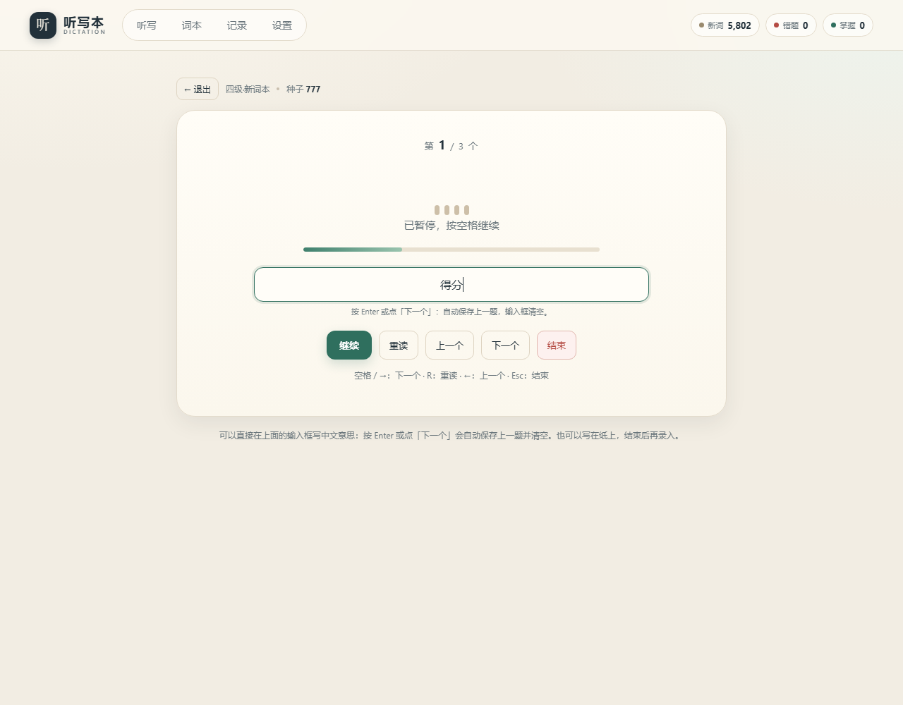
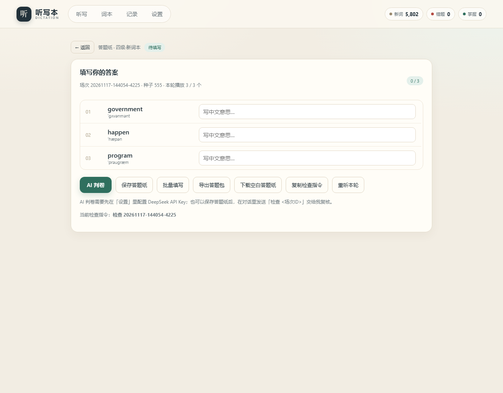
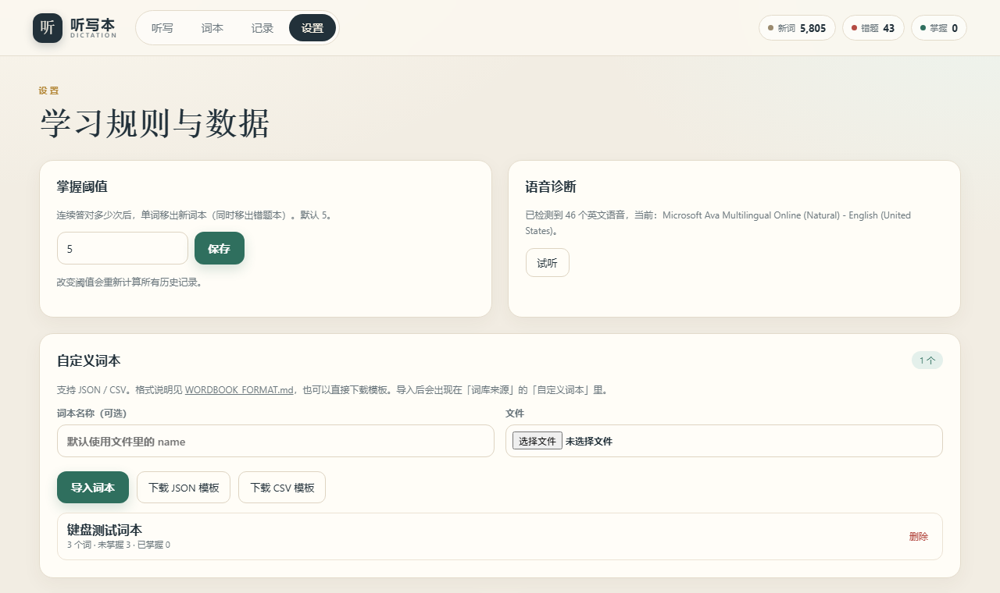

# 听写本

> 当前版本：v0.3.0 · [Releases](https://github.com/Doerrrr/Lession-Exerise/releases)

一个本地运行的「机器读单词、你写中文意思、AI 检查」的听写工具。

- 四级 / 六级 / 六级新增 / 全部词库 / 错题本
- 支持导入自己的 JSON / CSV 词本
- 按词频取前 N 个，再用种子随机抽 K 个
- 听写页直接输入答案；按 Enter / 下一个自动保存上一题并清空
- 自动连读或「读完就停、按键下一个」
- 连续答对 5 次自动移出新词本；错词留在错题本
- 检查结果可以每词发音，也可以一键重听本轮错题
- 所有判卷都通过 DeepSeek / 兼容 API，不提供本地判卷
- 答题纸可以保存成 Markdown 作为备份
- 纯本地数据，不需要登录

## 截图








## 下载

- **Windows EXE**（免安装 Python，双击运行）：[Dictation-v0.3.0-win64.exe](https://github.com/Doerrrr/Lession-Exerise/releases/download/v0.3.0/Dictation-v0.3.0-win64.exe)
- **Android APK**（Android 8+，arm64）：[Dictation-v0.3.0-android.apk](https://github.com/Doerrrr/Lession-Exerise/releases/download/v0.3.0/Dictation-v0.3.0-android.apk)

EXE 首次运行会在 exe 旁边创建 `data/`；如果目录不可写会改用 `%APPDATA%\Dictation\data`。APK 是自签名安装包，需要在系统里允许「安装未知来源应用」；数据保存在应用私有目录。

## 快速开始（源码运行）

1. Windows 双击 `start.bat`；其他系统运行 `python server.py --open`。
2. 浏览器会自动打开 `http://127.0.0.1:8765`（端口被占用时会自动换一个，以窗口里打印的地址为准）。
3. 在「本轮设置」里选词库、数量、模式，点「开始听写」。
4. 第一次播放前允许浏览器发声；如果浏览器拦截了语音，点一下「继续」即可。

关闭启动窗口或按 `Ctrl+C` 停止服务。数据都在 `data/` 里，复制整个文件夹即可备份。

## 一轮怎么用

1. **设置**：词库来源、词频前 N 个、本轮听 K 个、种子、自动/手动、播放顺序（随机 / 按词频）、间隔、语速。
2. **听写**：机器读英文单词，你可以直接在页面输入框写中文意思；按 `Enter` 或点「下一个」会自动保存上一题并清空输入框。也可以写在纸上，结束后再录入。
   - 默认不显示英文，纯听力；需要时可以打开「显示英文」。
   - 自动模式读完一个、等设置的间隔、自动读下一个。不想等时，点「下一个」或按 `→` / `N` 立即跳下一个。
   - 手动模式读完停住，按空格 / Enter 读下一个；`R` 重读，`←` 上一个，`→` / `N` 下一个，`Esc` 结束。
3. **答题纸**：结束后页面列出本轮真正播放过的词，填入中文意思。
   - 可以逐题输入，也可以点「批量填写」打开对话框，一次粘贴：
     ```
     1. 放弃
     2. 能力
     ```
   - 先在「设置」里配置 DeepSeek API Key；点「AI 判卷」直接判分并更新词本。
   - 所有判卷都走 API；没有 Key 时不能判卷，可以保存/导出答题包作为备份。
4. **检查**：AI 判卷会使用本轮的单词、参考释义和你的答案；判完后错词会写进错题本。
   - 结果页每个单词都可以点小喇叭听；也可以点「重听本轮错题」只重听这一轮答错/未作答的词（会新建一轮专门的错题轮次）。
   - 不提供本地判卷 CLI，也不需要在对话里发「检查 ID」；所有判卷都在应用里完成。
5. **下一轮**：刷新页面，新词本/错题本数量已更新；错词可以直接用「错题本」来源再听。

## 导入自定义词本

支持把自己的单词表导进来，和内置词库共用听写、种子、新词本、错题本、AI 判卷。

1. 打开「设置 → 自定义词本」。
2. 选择 JSON 或 CSV 文件；也可以先点「下载 JSON 模板 / CSV 模板」。
3. 点「导入词本」。
4. 回到「听写」页，在「词库来源 → 自定义词本」里选择刚导入的词本。

固定格式说明见 [docs/WORDBOOK_FORMAT.md](docs/WORDBOOK_FORMAT.md)。JSON 示例：

```json
{
  "format": "dictation-wordbook",
  "version": 1,
  "name": "我的新词本",
  "words": [
    {"word": "abandon", "translation": "放弃；抛弃", "phonetic": "ə'bændən", "frequency": 1000},
    {"word": "ability", "translation": "能力；才干", "phonetic": "ə'biliti", "frequency": 800}
  ]
}
```

CSV 示例：

```csv
word,translation,phonetic,frequency
abandon,放弃；抛弃,ə'bændən,1000
ability,能力；才干,ə'biliti,800
```

- 文件 UTF-8、最多 2 MB、最多 10,000 个词；只收单个英文单词。
- 导入后词本存在 `data/wordbooks/`（个人数据，已被 `.gitignore` 排除）。
- 每个词本会生成「新词本」和「全部」两个听写来源，并参与全局错题本和已掌握。
- 删除词本不会删除历史听写记录。

## 新词本 / 错题本规则

- **新词本**：一开始包含所选词库的全部单词。
- 每次检查答对，连续答对次数 `+1`；答错则清零，错误次数 `+1`。
- 连续答对 **5 次**（可在设置里改）→ 移入「已掌握」，下一轮不再出现。
- **错题本不是另一套词**，它是新词本里「答错过、且尚未掌握」的视图。连续答对 5 次后，它同时从新词本和错题本消失。
- 「已掌握」里的词可以点「重新学习」放回新词本，从零开始累计。

同一轮里每个词只出现一次，所以「连续 5 次」是跨 5 轮检查累计的。

## 种子与可复现

- 每轮自动生成 6 位种子，也可以手动填写。
- 相同种子 + 相同词库状态 + 相同候选池 + 相同数量 → 同一组词、同一顺序。
- 播放顺序可选「随机」（按种子打乱）或「按词频」（从高频到低频）。
- 词库状态会随着掌握进度变化，因此旧种子在进度变化后不保证复现。
- 每轮的实际词表完整保存在 `data/sessions/<场次ID>.json`；检查以场次 ID 为准，种子只是展示和复现参考。
- 在历史里点「重听」可以原样重听某一轮。

## 答题纸与检查

保存后文件在：

```
data/sessions/<场次ID>-answers.md
```

格式很简单，也可以手填：

```
1. abandon
   你的答案：放弃
2. ability
   你的答案：能力
```

答题页的「导出答题包」会导出带场次 ID、种子和你的答案的 Markdown，作为备份；它不参与判卷。

**所有判卷都通过 API**：在答题页点「AI 判卷」，应用会调用 DeepSeek / 兼容接口，结果写入 `data/checks/`。

- 不提供本地判卷，也没有 `tools/check.py` 之类的本地检查命令。
- 没有 API Key 时无法判卷；请先在设置里配置。
- 同一轮重复 AI 判卷会覆盖旧检查记录，不会重复累计连对。
- AI 判错或返回 `uncertain` 时，可以人工核对后重新点 AI 判卷，或用「重新学习」修正进度；不要用本地规则改判。

## AI 判卷（DeepSeek）

所有判卷都由 API 完成：

1. 打开「设置」→「AI 判卷（DeepSeek）」。
2. 填入你的 API Key（默认模型 `deepseek-chat`，Base URL `https://api.deepseek.com`），保存并点「测试连接」。
3. 听写结束后填写答案，点「AI 判卷」。应用会把本轮的单词、参考释义和你的答案发给 DeepSeek，然后自动更新新词本/错题本。

说明：

- Key 只保存在本机 `data/secrets.json`，不会回传给浏览器；不要把这个文件发给别人。
- 判卷会调用 DeepSeek API，按你的账号计费；一轮一次请求。
- AI 返回不完整时会直接报错，不会偷偷改用本地匹配。
- 判卷使用固定、较长的评分规则前缀，DeepSeek 会自动命中 context cache；结果页会显示「缓存命中 / 未命中 tokens」（如果 API 返回 usage）。每轮的单词和答案不同，动态部分无法跨轮命中，这是正常的。
- 模型和 Base URL 可改，兼容 OpenAI 风格的 `/chat/completions` 接口。
- 不配置 Key 也能听写、记录、导出答题包，但不能判卷。

## 数据文件

```
data/
├─ words.json                 词库（ECDICT，构建后约 1.2 MB）
├─ settings.json              掌握阈值等设置
├─ secrets.json               DeepSeek API Key（本机私有，不要外发）
├─ sessions/                  每轮配置、词表、答案键、答题纸
├─ checks/                    检查记录 + 报告（进度由它们派生）
├─ wordbooks/                 导入的自定义词本（个人数据）
├─ resets.json                单词重置记录
└─ archive/                   「清空学习记录」时归档的旧检查
```

注意：`data/sessions/<id>.json` 里含正确释义（答案键），不要在看答案前自己打开。

## 语音

- 使用浏览器 Web Speech API，优先选择英文自然音色（如 Microsoft Aria / William / Jenny）。
- 推荐用 **Edge**；Chrome 也可以。Windows 自带的英文语音通常可用。
- 如果下拉框没有英文语音：Windows 设置 → 时间和语言 → 语音 → 添加英文语音，然后刷新页面。
- 如果蓝牙耳机在第一个词前还没激活，打开「耳机保活（蓝牙预热）」；应用会用极低音量的静音音频保持音频通道，系统静音也有效。也可以先点「试听语音」预热。
- 页面切到后台会自动暂停，避免漏词；回到页面后按空格继续。
- 如果第一次播放提示 `not-allowed`，点「继续」重试，或在设置里换一个英文音色。

## 词库说明

- 词库来自 [ECDICT](https://github.com/skywind3000/ECDICT)（MIT License），按 `cet4` / `cet6` 标签筛选，只保留单词、连字符和撇号词条。
- 当前构建：全部 5,802 词；四级 3,846；六级 5,406；六级新增 1,956。这是 ECDICT 的词根/原形标注数量，不等同于官方大纲的「含派生词条数」。
- 词频采用 ECDICT 的 `frq`（COCA 当代语料库词频顺序，数值越小越常用），作为「听力词频」的近似；不是专门的四六级听力真题词频。
- 重新构建词库（需要联网下载一次约 66 MB 的 CSV）：

  ```bat
  python tools\build_words.py
  ```

## 测试

```bat
python -m unittest discover -s tests -v
```

当前 42 个测试通过（本地判卷相关测试已随功能移除）。

## 当前版本没有做

- 本地判卷（现在所有判卷都走 DeepSeek / 兼容 API，不提供本地 CLI）
- 拍照 OCR 检查
- 多词短语 / 派生词自动展开

需要的话可以在下一版加。

## License

- 应用代码：MIT，见 [LICENSE](LICENSE)。
- 词库数据：ECDICT，MIT，见 [THIRD_PARTY_NOTICES.md](THIRD_PARTY_NOTICES.md)。

